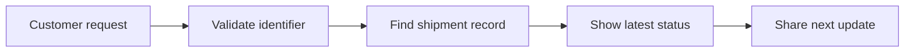

## Overview

Tracking and visibility help you answer one simple question: where is the shipment right now?

In CFC Ops, you can use a tracking number, a reference number, or a customer-facing link to check shipment progress, share updates, and spot delays early. This guide shows you a starter-kit workflow you can adapt to your own operations.

<Callout kind="tip">

This page is a template. Replace the sample statuses, timelines, and access rules with your own operational process.

</Callout>

## Core tracking options

Use the right identifier based on who is asking and what system you have open.

<Columns cols={3}>
  <Card title="Tracking number" icon="bar-chart" href="#tracking-number">
    Best for direct shipment lookups when you already have the carrier or manifest ID.
  </Card>
  <Card title="Reference number" icon="book-open" href="#reference-number">
    Best for customer service teams that work from order IDs, purchase orders, or booking numbers.
  </Card>
  <Card title="Visibility link" icon="external-link" href="#customer-access">
    Best for customers who need read-only access to shipment progress.
  </Card>
</Columns>

### Tracking number

A tracking number usually points to a single shipment or consolidation unit. You can use it when you want the most precise record available.

Common examples include:
- Dispatch IDs
- Manifest numbers
- Carrier tracking references
- Internal load identifiers

### Reference number

A reference number is useful when the customer uses their own order or invoice number instead of the logistics system ID. Keep a clear mapping between the reference number and the shipment record so your team can find it quickly.

### Customer access

A customer-facing link should show only the information that helps the recipient understand progress. Do not expose internal notes, private contact details, or operational overrides.

## How the tracking flow works

The basic flow is simple: you receive an identifier, you validate it, you query the shipment record, and you return the latest status.



<Steps>
  <Step title="Collect the identifier" icon="search">
    Ask for the tracking number, the reference number, or both. If the user provides a receipt, confirm that the shipment date and origin match the request.
  </Step>
  <Step title="Check shipment status" icon="check-circle">
    Review the latest scan event, current location, and estimated delivery window. If the shipment has not moved recently, check for an exception.
  </Step>
  <Step title="Share a clear update" icon="send">
    Return a short status summary in plain language. Include the current milestone, the next expected step, and any action the customer needs to take.
  </Step>
</Steps>

## Status milestones

You should keep milestone names consistent so customers can understand progress at a glance.

<Tabs>
  <Tab title="Pre-shipment" icon="package">
    
    The shipment is created but not yet handed off. Use this status for booked loads, pending pickup, or documents in review.
    
    Typical message: `Your shipment is scheduled and awaiting dispatch.`
    
  </Tab>
  <Tab title="In transit" icon="truck">
    
    The shipment is moving between facilities or destinations. Use this for linehaul movement, cross-dock transfers, and route progress.
    
    Typical message: `Your shipment is currently in transit and moving toward the destination.`

  </Tab>
  <Tab title="Delivered" icon="check">
    
    The shipment has reached the destination and the delivery event is complete. Include proof of delivery when your process supports it.
    
    Typical message: `Your shipment has been delivered successfully.`
    
  </Tab>
  <Tab title="Exception" icon="alert-triangle">
    
    The shipment needs attention because of a delay, address issue, missing document, weather interruption, or failed delivery attempt.
    
    Typical message: `Your shipment is delayed and requires review.`
    
  </Tab>
</Tabs>

## Example status lookup

Use a structured response so your support team and customers see the same information.

<CodeGroup tabs="JavaScript,cURL,Python">
  ```javascript
  const response = await fetch("https://api.example.com/trackings/CFYC-2025-00482");
  const data = await response.json();

  console.log({
    trackingNumber: data.trackingNumber,
    status: data.status,
    location: data.location,
    eta: data.estimatedDeliveryDate
  });
  ```

  ```bash
  curl -X GET "https://api.example.com/trackings/CFYC-2025-00482" \
    -H "Accept: application/json"
  ```

  ```python
  import requests

  response = requests.get(
      "https://api.example.com/trackings/CFYC-2025-00482",
      headers={"Accept": "application/json"},
      timeout=30,
  )

  data = response.json()
  print(data["status"], data["estimatedDeliveryDate"])
  ```
</CodeGroup>

A typical result may include the current status, the latest scan timestamp, the last known facility, and the estimated delivery date.

## Exceptions and delay handling

Not every shipment follows the expected route. When an exception happens, focus on clarity, speed, and ownership.

<Callout kind="alert">

Do not promise a new delivery date until you confirm the cause of the exception and the next operational step.

</Callout>

Common exception types include:

| Exception type | What it means | What you should do |
| --- | --- | --- |
| Address issue | Delivery address needs correction | Verify the address and request the missing detail |
| Missed connection | Shipment did not make the planned transfer | Recheck routing and confirm the next move |
| Delivery attempt failed | The driver could not complete delivery | Notify the customer and share the next attempt window |
| Weather delay | Conditions slowed or stopped movement | Update the expected timeline and monitor the route |
| Documentation hold | Required paperwork is incomplete | Resolve the missing document before release |

## Customer tracking access

Customer access works best when it is simple and read-only. Give users enough detail to understand progress, but keep internal data private.

### Recommended access rules

- Show shipment status, milestone history, and delivery window
- Hide internal comments and staff-only notes
- Mask sensitive contact information when possible
- Log access for audit and support review

### Sharing best practices

If you send tracking access by email or message, make the link easy to find and easy to verify. Use one clear call to action, and include a fallback contact method in case the customer cannot open the page.

<Expandable title="Advanced tracking fields" default-open="false">
  
  You can extend your tracking page with service level, route history, signature details, and exception notes. Keep advanced fields behind a collapsible section so the default view stays clean.
  
  Useful fields include:
  
  - Shipment class
  - Pickup timestamp
  - Destination terminal
  - Last scan source
  - Delivery confirmation method
  
</Expandable>

## Quick implementation checklist

Before you publish tracking to your users, review this checklist.

1. Confirm which identifier types you support.
2. Standardize status labels across all customer touchpoints.
3. Decide which exception types are visible to customers.
4. Define how often shipment data refreshes.
5. Test the experience from a support and customer perspective.

<Callout kind="info">

If you customize this template, keep the same structure: identifier, status, milestone, exception, and customer access. That makes it easier to train your team and document your workflow.

</Callout>